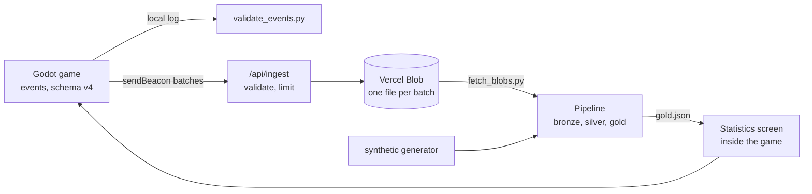

# Coin Collector

A small 2D platformer built with Godot, used as the source of a complete data loop: the game records its actions as schema-validated events, a serverless endpoint collects them from the web build, a Python/DuckDB pipeline turns them into metrics, and the game shows those metrics on its own statistics screen.

A study project, kept small on purpose. It is meant to show: events with a documented schema, a bronze/silver/gold pipeline tested against known truth, an ingestion endpoint treated as hostile input, CI that tests and deploys everything, and decisions written down ([8 ADRs](docs/adr/)). Rules for working on it with a coding agent are in [`AGENTS.md`](AGENTS.md).

## How it fits together



| Folder | What |
|---|---|
| game (`*.gd`, `main.tscn`) | The platformer, seeded levels, touch controls, Esc menu |
| [`schema/`](schema/) | The event contract: one JSON Schema per version |
| [`ingest/`](ingest/) | The collection endpoint (Node, Vercel function) and its tests |
| [`pipeline/`](pipeline/) | Bronze/silver/gold in DuckDB, Blob downloader, synthetic data, tests |
| [`stats/`](stats/) | The statistics screen; reads the pipeline's gold JSON |
| [`tests/`](tests/) | Headless Godot checks |
| [`.github/workflows/`](.github/workflows/) | Deploy, and the manual real-data run |

More detail (gameplay, level generation, event tables, every file) is in [`docs/reference.md`](docs/reference.md).

## Quick start

Install [Godot 4.7](https://godotengine.org/) (tested with 4.7.2), import `project.godot` and press F5. Keyboard: **A/D** or arrows to move, **W**/**Space** to jump, **Esc** for the menu. On touch screens an on-screen stick and jump zone appear (add `?touch` to the address to try them with a mouse).

```bash
pip install -r requirements.txt -r pipeline/requirements.txt
python -m unittest discover -s pipeline/tests -t .
godot --headless --path . --script res://tests/check_stats.gd
```

## The pieces

**Levels.** Every round after the first plays a level generated from a seed. A headless test simulates the player on 634 seeds to confirm every coin can be reached alive. That is a large sample, not a proof.

**Events.** Each action is one JSON line with a timestamp, event name, `valor`, session and round ids, and `schema_version` (now 4). [`validate_events.py`](validate_events.py) checks a log against the schema and cross-checks counters per round.

**Pipeline** ([`pipeline/`](pipeline/), [ADR 0005](docs/adr/0005-medallion-pipeline-tested-against-synthetic-truth.md)). Bronze keeps every line as received, silver types them and quarantines bad ones with a reason, gold holds the metrics (rounds, completion rate, duration, death rate, deaths by cause, deadliest levels, data quality). A synthetic generator adds dirty rows and a manifest of the true answers, and the tests compare the pipeline against it.

```bash
python -m pipeline.generate_synthetic --out pipeline/data/raw/synthetic --days 40
python -m pipeline.run_pipeline --raw pipeline/data/raw/synthetic --out stats/data/gold.json
```

**Statistics screen** ([ADR 0007](docs/adr/0007-statistics-screen-lives-inside-the-game.md)). **Esc > Statistics** shows the gold layer over the paused game and says on screen whether the data is synthetic. It is a snapshot bundled at deploy time, not live data. On `main`, the deploy downloads the collected batches and uses them when at least one real session exists; below 10 sessions the badge says `early data`.

**Collection** ([ADR 0008](docs/adr/0008-collect-events-with-sendbeacon-and-blob.md)). The web build batches events in the page and sends them with `sendBeacon` to `/api/ingest`, which validates shape and size, limits each client, and stores one blob per batch in a private Vercel Blob store. Nothing is sent from the desktop build; a first-visit notice and **Esc > Send anonymous statistics** let players opt out, and no IP or browser data is stored. `INGEST_ENABLED=false` switches collection off without a deploy.

```bash
pip install -r pipeline/requirements-fetch.txt
python -m pipeline.fetch_blobs --out pipeline/data/raw/real      # needs BLOB_READ_WRITE_TOKEN in the environment or .env.local
```

In CI no Blob token is stored: the workflows pull a short-lived credential from Vercel with the deploy secrets, and the manual [`real-data.yml`](.github/workflows/real-data.yml) keeps only the aggregated `gold.json` as an artifact.

**Deploy.** Work happens on `dev` or `feature/*`; `main` only takes merges from `dev`. [`deploy.yml`](.github/workflows/deploy.yml) tests the pipeline and the endpoint, builds the statistics data, checks the game, exports the web build and deploys it to Vercel with the CLI: `main` is production, other branches get previews. It needs the secrets `VERCEL_TOKEN`, `VERCEL_ORG_ID` and `VERCEL_PROJECT_ID`.

## Known limits

- **Collected data is bounded, not trustworthy.** Anyone can post well-formed fake events: the origin check is not authentication and the rate limit is per serverless instance. A real fence would be a firewall rule and signed batches.
- **"Real plays" can mean very few plays.** With a handful of sessions the numbers are mostly the author's own test plays.
- **Delivery is best effort.** `sendBeacon` has no response to read, so the end of a session can be lost; the local log is complete.
- **Not verified here:** touch controls on real phones, `sendBeacon` on a real tab close, and the endpoint tests locally (they run in CI).

## How it was built

Most of the code was written with [Claude Code](https://claude.com/claude-code) under the rules in [`AGENTS.md`](AGENTS.md): changes go through `dev`, nothing is committed or pushed without the owner's go-ahead, secrets never enter the repository, and what could not be checked is reported as unchecked. Decisions are recorded as ADRs as they were made.

## Credits

Art: [Pixel Adventure 1](https://pixelfrog-assets.itch.io/pixel-adventure-1) by Pixel Frog (CC0). Music: "Jungle Prince" by iamoneabe (CC0). Sound effects are generated by [`tools/generate_sfx.py`](tools/generate_sfx.py). Details in [`assets/CREDITS.md`](assets/CREDITS.md).

Built with Godot 4.7 (GDScript), Python 3 with DuckDB and jsonschema, Node 20, Vercel and GitHub Actions.
