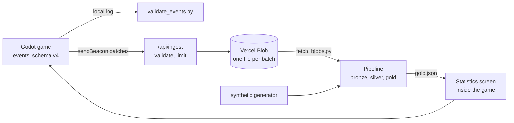

# Coin Collector

A small 2D platformer built with Godot, used as the source of a complete data loop: the game records every action as schema-validated events, a serverless endpoint collects them from the web build, a Python/DuckDB pipeline turns them into metrics, and the game shows those metrics on its own statistics screen.

It is a study project, kept small on purpose. What it is meant to show: events with a documented schema, a bronze/silver/gold pipeline tested against known truth, an ingestion endpoint treated as hostile input, CI that tests and deploys everything, and written design decisions ([8 ADRs](docs/adr/)). Rules for working on it with a coding agent are in [`AGENTS.md`](AGENTS.md).

## How it fits together



| Where | What |
|---|---|
| game (`*.gd`, `main.tscn`, `level.gd`) | The platformer, seeded level generator, touch controls and the Esc menu |
| [`schema/`](schema/), [`validate_events.py`](validate_events.py) | The event contract (one JSON Schema per version) and a consistency validator |
| [`ingest/`](ingest/) | The collection endpoint (Node, Vercel function) and its tests |
| [`pipeline/`](pipeline/) | Bronze/silver/gold in DuckDB, the Blob downloader, a synthetic data generator, tests |
| [`stats/`](stats/) | The statistics screen; reads the pipeline's gold JSON |
| [`tests/`](tests/) | Headless Godot checks (levels, menu, statistics, sender, touch controls) |
| [`.github/workflows/`](.github/workflows/) | Deploy (test, export, publish) and the manual real-data run |
| [`docs/adr/`](docs/adr/), [`GLOSSARY.md`](GLOSSARY.md), [`AGENTS.md`](AGENTS.md) | Decisions, domain terms, working agreement |

## Quick start

1. Install [Godot 4.7](https://godotengine.org/) (tested with 4.7.2), import `project.godot` and press F5.
2. Install the Python dependencies and run the checks:

```bash
pip install -r requirements.txt -r pipeline/requirements.txt
python -m unittest discover -s pipeline/tests -t .
godot --headless --path . --script res://tests/check_stats.gd
```

## Gameplay

- Move the blue square with **A/D** or the **left/right arrows**. Jump with **W**, **Space** or the **up arrow**.
- Collect every coin (the fruits) in the level. Grass-topped blocks are solid: you can stand on them and cannot pass through them.
- Spikes are traps (only the visible spike tips kill), and falling into a gap in the ground is also fatal. Dying plays a short "hit" animation, then after 0.6 seconds puts you back at the start of the level with every coin restored, and the round keeps going.
- There is no time limit. The round is complete when you have collected every coin in one attempt. Press **Enter** for a new level.
- **Touch screens** get on-screen controls drawn over the game: an analog stick that appears under your left thumb (push gently to walk, fully to run), the right half of the screen to jump, and a pause button in the top right corner that opens the same menu as **Esc**, where **Sound** mutes everything (like **M**). On a computer, add `?touch` to the address to try them with the mouse.
- The first round of a session plays the hand-made level (level 0). Every later round plays a randomly generated one; its seed is shown in the corner.
- **Esc** opens a menu and pauses the game (the round clock and the event log stop with it): resume, **choose your character** (Ninja Frog, Mask Dude, Pink Man or Virtual Guy, remembered between visits) and open the **statistics** screen. The choice is a personal setting and is not part of the telemetry.
- Everything is drawn with pixel art from the Pixel Adventure pack: the player faces the direction of movement and switches between idle, run, jump and fall animations (a short "hit" animation plays where you die), coins are animated fruits with a burst when collected, the terrain uses grass-topped tiles, and a tiled sky background drifts slowly behind. Background music loops during play, and jumping, collecting a fruit, dying and finishing a level each play a sound effect; **M** mutes everything. **F1** shows the real collision shapes (player box, spike hitboxes, coin circles), which are independent of the art.

## Level generation

`Level.generate(seed)` in [`level.gd`](level.gd) builds a one-screen level from an integer seed, so the same seed always gives the same level. It places ground segments separated by pits, short chains of platforms, spikes, solid blocks and 6–9 coins, using rules that keep everything within jump range (about 100 px high and 170 px across). Every solid and trap sits on a 16 px grid so the tile art lines up.

Rules are not a guarantee, so [`tests/verify_levels.gd`](tests/verify_levels.gd) checks the result: it runs structural checks (counts, no overlaps, 16 px grid) and then simulates the player — walking and jumping with direction changes mid-air, using the same physics as the game — to confirm every coin can be touched on a path where the player stays alive. The hand-made level and 634 generated ones (seeds 1–181 and three ranges of 151 seeds, including seeds that exposed bugs while the generator was being built) pass. That is a large sample, not a proof: an unverified seed could still produce an unfinishable level.

```bash
godot --headless --path . --script res://tests/verify_levels.gd -- --from=0 --seeds=60
godot --headless --path . --script res://tests/simulate_round.gd   # scripted play that writes a real log
```

## Event log

Events are appended to `user://events.jsonl` (on Windows: `%APPDATA%\Godot\app_userdata\Coin Collector\events.jsonl`), one JSON object per line:

```json
{"timestamp":"2026-11-02T03:30:09.621Z","evento":"round_start","valor":{"level_seed":1891284687,"t":0.0},"session_id":"f983eb31-7604-4041-b3dc-b8cfe6b5da70","round_id":"8fd44feb-ba38-4977-95d9-00590a7e0b2b","schema_version":4}
```

| Field | Description |
|---|---|
| `timestamp` | UTC time, ISO 8601 with milliseconds |
| `evento` | Event type (below) |
| `valor` | Object whose fields depend on `evento` |
| `session_id` | UUID of the game session (one program run) |
| `round_id` | UUID of the round, or `null` for session events |
| `schema_version` | `4` (`1` arena, `2` platformer with one fixed level, `3` generated levels) |

In `valor`, `t` is seconds since the round started, and `x`/`y` are level coordinates (800×600, y grows downward).

| `evento` | Fired when | `valor` |
|---|---|---|
| `session_start` | the game starts | `{}` |
| `round_start` | a round begins | `t`, `level_seed` (0 = hand-made level, otherwise the generator seed), `generator_version` |
| `coin_spawn` | a coin is placed, at round start and after every death | `t`, `coin_id`, `x`, `y` |
| `coin_collect` | the player takes a coin | `t`, `coin_id`, `x`, `y`, `dt` (seconds since it last spawned) |
| `player_position` | every 0.5 s during a round | `t`, `x`, `y` |
| `player_jump` | the player jumps | `t`, `x`, `y` |
| `player_land` | the player lands after being airborne | `t`, `x`, `y`, `vy` (impact speed, px/s) |
| `player_death` | a trap is touched or the player falls into a pit | `t`, `x`, `y`, `cause` (`trap` or `pit`) |
| `player_respawn` | at the start point, 0.6 s after a death | `t`, `x`, `y` |
| `round_end` | the round finishes or the window is closed | `t`, `completed`, `coins_collected`, `coins_total`, `deaths`, `jumps`, `position_samples`, `duration_s` |
| `session_end` | the window is closed | `{}` |

`round_end.coins_collected` counts every `coin_collect` in the round, across attempts. `completed` is `false` when the window was closed before all coins were collected.

The formal definitions are in [`schema/`](schema/), one JSON Schema 2020-12 file per `schema_version`. A level is determined by its seed *and* the version of the level code, so `level_seed` plus `generator_version` is what lets an analysis reconstruct the layout a round was played on. The version goes up whenever the hand-made level or the generator changes (schema 3 logs correspond to version 1). Design decisions are recorded in [`docs/adr/`](docs/adr/), and domain terms in [`GLOSSARY.md`](GLOSSARY.md).

## Validating the data

```bash
python -m venv .venv
.venv/Scripts/pip install -r requirements.txt   # Windows; use .venv/bin/pip elsewhere
.venv/Scripts/python validate_events.py [path/to/events.jsonl]
```

Without an argument it reads the default Windows log path. Each line is checked against the schema for its own `schema_version`, so logs from both versions validate. On top of the schema it verifies per round that:

- the round starts once, ends once, and event times never go backwards;
- the `round_end` counters match the recorded `coin_collect`, `player_position`, `player_jump` and `player_death` events;
- every death is followed by a respawn, and nothing but `coin_spawn` is recorded while the player is dead;
- every attempt spawns each coin exactly once, at the same place;
- a round marked `completed` collected all of its coins.

It exits with `0` when everything passes and `1` when there are problems.

## Telemetry pipeline

[`pipeline/`](pipeline/) turns the event log into metrics with Python and [DuckDB](https://duckdb.org/), in three layers (a "medallion" architecture):

| Layer | Holds | Where |
|---|---|---|
| **Bronze** | every line exactly as received, with source file and line number, broken lines included | `bronze.raw_events` |
| **Silver** | clean, typed events with schema versions 2, 3 and 4 conformed to one shape, plus `quarantine`: each rejected line with one reason (`invalid_json`, `missing_field`, `invalid_timestamp`, `timestamp_out_of_range`, `unsupported_schema_version`, `unknown_event`, `value_out_of_range`, `duplicate`) | `silver.events`, `silver.rounds`, `silver.deaths`, `silver.quarantine` |
| **Gold** | the metrics | `gold.daily_metrics`, `gold.summary`, `gold.deaths_by_cause`, `gold.deadliest_levels`, `gold.data_quality` |

Metrics, per day in UTC: **rounds**, **completion rate** (completed rounds over rounds that ended), **average and median duration** of completed rounds, and **death rate** (deaths over attempts, where an attempt is one start of the level: the first of each round plus one per respawn).

```bash
pip install -r pipeline/requirements.txt
python -m pipeline.generate_synthetic --out pipeline/data/raw/synthetic --days 40      # synthetic demo data, with dirty rows
python -m pipeline.run_pipeline --raw pipeline/data/raw/synthetic --out pipeline/data/gold.json
python -m pipeline.run_pipeline --raw "$APPDATA/Godot/app_userdata/Coin Collector/events.jsonl" --label "real plays"
python -m unittest discover -s pipeline/tests -t .                                      # checks everything against ground truth
```

The synthetic generator is **not real players**: it writes days of plausible events and adds dirty rows on top, along with a `manifest.json` of the true answers, which the tests compare the pipeline against. See [ADR 0005](docs/adr/0005-medallion-pipeline-tested-against-synthetic-truth.md).

## Statistics screen

**Esc > Statistics** opens, over the paused game, a screen with the pipeline's gold layer: headline numbers (rounds, completion rate, average time, death rate as `deaths / attempts`), rounds and death rate per day, deaths by cause, the deadliest levels and a data-quality summary. **Esc** steps back one level at a time (statistics, then the menu). The code is in [`stats/`](stats/): it only reads `stats/data/gold.json`, written by the pipeline and bundled into the game when it is exported, and it says on screen whether the data is synthetic.

```bash
python -m pipeline.run_pipeline --raw pipeline/data/raw/synthetic --out stats/data/gold.json
godot --headless --path . --script res://tests/check_stats.gd      # numbers on screen == gold numbers
```

Without `stats/data/gold.json` (it is git-ignored) the screen says there is no data and how to generate it. On deploy, the workflow tests the pipeline, builds synthetic demo data, runs it through bronze, silver and gold, checks the game and bundles the result, so the screen is a snapshot taken at deploy time, not live data (see [ADR 0007](docs/adr/0007-statistics-screen-lives-inside-the-game.md)). On `main` the deploy then downloads the collected batches and, if at least one real session exists, replaces the synthetic data with the real aggregate; the badge says `REAL PLAYS` and, below 10 sessions, `early data` (those numbers are mostly the author's own test plays).

## Collecting events from the web build

The web build can send the events of a play session to a small collection endpoint, which stores each batch untouched as a JSON Lines file in [Vercel Blob](https://vercel.com/docs/vercel-blob). Those files are the raw input of the bronze layer, so real players flow through the same pipeline as the synthetic data. Nothing is sent from the desktop build, and the game says so up front: the first visit shows a notice, and **Esc > Send anonymous statistics** switches it off for good. Only the events described in the schema are sent, with a random session id; no account, IP address or browser data is stored.

- **In the page** ([`event_sender.gd`](event_sender.gd)): a few lines of JavaScript buffer the events and send a batch every 10 seconds, when 50 events pile up, and when the page is hidden or closed (`navigator.sendBeacon`). Delivery is best effort; the local log is unaffected.
- **Endpoint** ([`ingest/api/ingest.js`](ingest/api/ingest.js)): accepts `POST /api/ingest` from its own origin only (a browser-side check, not authentication), limits each client to 20 batches a minute (best effort), rejects anything that is not a well-formed batch ([`_validate.js`](ingest/api/_validate.js): at most 100 events and 64 KB, known event names, schema version 4, a single session per batch) and writes one blob per batch. Game rules are not checked here: a well-formed but nonsensical event is stored and quarantined later by the silver layer. Setting `INGEST_ENABLED=false` in the Vercel project turns collection off without a deploy.
- **Tests:** `cd ingest && npm test` for the validation, `godot --headless --path . --script res://tests/check_sender.gd` for the event sink and the privacy switch. `python tools/serve_web.py` also answers `/api/ingest` locally (appending to `build/received_events.jsonl`), which is how the sender is tried in a browser.

**Using the collected events:** [`pipeline/fetch_blobs.py`](pipeline/fetch_blobs.py) downloads the uploaded batches into a folder, skipping the ones it already has (blobs are never overwritten), and that folder is a bronze source like any other:

```bash
pip install -r pipeline/requirements-fetch.txt          # the Vercel SDK, only needed for this step
python -m pipeline.fetch_blobs --out pipeline/data/raw/real
python -m pipeline.run_pipeline --raw pipeline/data/raw/real --out stats/data/gold.json --label "real plays"
```

Locally it reads `BLOB_READ_WRITE_TOKEN` from the environment or from a git-ignored `.env.local` (never commit it). `--skip-session <id>` leaves out a test upload. In CI no Blob token is stored anywhere: the workflows log in to Vercel with the deploy secrets and pull a short-lived credential (`vercel env pull`), and the manual workflow [`real-data.yml`](.github/workflows/real-data.yml) keeps only the aggregated `gold.json` as an artifact, never the raw batches.

Setup in Vercel: create a **private** Blob store and connect it to the project (that adds `BLOB_READ_WRITE_TOKEN`). The deploy workflow copies `ingest/api` next to the exported game, because Vercel only sees `build/web`. See [ADR 0008](docs/adr/0008-collect-events-with-sendbeacon-and-blob.md).

## Web build and deployment

The game also runs in the browser: Godot exports it to WebAssembly (single-threaded, so no special headers are needed). The picture is scaled to the window and centered, keeping its 800×600 proportions. The `Web` preset in [`export_presets.cfg`](export_presets.cfg) writes to `build/web/` (git-ignored).

- **Branches:** work happens on `dev` or on a `feature/*` branch; `main` only receives merges from `dev` when a version is ready to publish.
- **Deploying:** [`.github/workflows/deploy.yml`](.github/workflows/deploy.yml) tests the pipeline, builds the statistics data, checks the game, exports it on every push to `main`, `dev` or `feature/**` and deploys it to [Vercel](https://vercel.com) with the Vercel CLI: `main` becomes the production deployment and the others preview deployments. Vercel cannot export a Godot project itself, so the build runs on GitHub Actions and only the result is uploaded. The repository's [`vercel.json`](vercel.json) turns off Vercel's own Git builds, which would only see source code. The workflow needs three repository secrets (Settings > Secrets and variables > Actions): `VERCEL_TOKEN`, `VERCEL_ORG_ID` and `VERCEL_PROJECT_ID`.
- **Templates:** the web export templates are fetched by [`tools/fetch_web_templates.py`](tools/fetch_web_templates.py), which downloads only the web part (about 40 MB) of the official 1.2 GB templates archive.
- **Try it locally:** install the web templates, then export and serve:

```bash
python tools/fetch_web_templates.py --version 4.7.2 --dest "$APPDATA/Godot/export_templates/4.7.2.stable"   # Windows path
godot --headless --path . --export-release "Web" build/web/index.html
python tools/serve_web.py          # http://127.0.0.1:8060/index.html
```

On the web, `user://events.jsonl` lives in the browser's own storage; what reaches the collection endpoint is sent separately (see above). Browsers also only allow sound after the first key press or click.

## Known limits

- **The collected data is not trustworthy, only bounded.** Anyone can post well-formed fake events: the origin check is not authentication and the per-client limit is per serverless instance. The real fence would be a firewall rate-limit rule and signed batches ([ADR 0008](docs/adr/0008-collect-events-with-sendbeacon-and-blob.md)).
- **"Real plays" can mean very few plays.** With a handful of sessions the numbers are mostly the author's own test plays; the statistics badge says `early data` below 10 sessions.
- **Delivery is best effort.** `sendBeacon` has no response to read, so the tail of a session can be lost; the local log is complete.
- **Not verified here:** touch controls on real phones, `sendBeacon` on a real tab close, and the ingestion tests locally (they run in CI).

## How it was built

Most of the code was written with [Claude Code](https://claude.com/claude-code) under the rules in [`AGENTS.md`](AGENTS.md): changes go through `dev`, nothing is committed or pushed without the owner's go-ahead, secrets never enter the repository, and what could not be checked is reported as unchecked. Design decisions are recorded as ADRs as they were made, and a change that reverses one updates it.

## File reference

<details>
<summary>Every source file and what it does</summary>

| File | Purpose |
|---|---|
| `project.godot`, `main.tscn` | Project settings and main scene (a single `Node2D` with a script) |
| `main.gd` | Game rules, event logging and drawing with native shapes; `_step()` is input-free so it can be simulated |
| `player_view.gd` | `PlayerView`: sprite animations and mirroring for the chosen character, driven by the physics body; purely visual |
| `pause_menu.gd`, `avatars.gd`, `settings.gd` | The Esc menu, the list of playable characters, and the saved choice (`user://settings.cfg`) |
| `assets/` | Art, sounds and their credits ([`assets/CREDITS.md`](assets/CREDITS.md)) |
| `tools/generate_sfx.py` | Synthesizes the sound effects into `assets/sounds/` (no third-party audio) |
| `tools/fetch_web_templates.py`, `tools/serve_web.py` | Install the web export templates; serve the web build locally |
| `export_presets.cfg`, `vercel.json`, `.github/workflows/` | Web export preset, Vercel configuration and the deploy workflow |
| `level.gd` | `Level`: the hand-made level and the seeded generator |
| `scrolling_background.gd` | `ScrollingBackground`: the drifting tiled sky; purely visual |
| `sfx.gd` | `Sfx`: plays the sound effects and handles mute |
| `music.gd` | `Music`: loops the background track |
| `level_view.gd` | `LevelView`: terrain tiles, spikes and animated fruit coins; purely visual |
| `platform_physics.gd` | `PlatformPhysics`: gravity, jumping and collisions as pure functions, shared by the game and the tests |
| `event_logger.gd` | `EventLogger`: adds ids, timestamp and schema version, appends one JSON line |
| `event_sender.gd` | `EventSender`: batches the event lines in the page and sends them with `sendBeacon` (web build only) |
| `touch_controls.gd` | `TouchControls`: floating analog stick, jump zone and menu button for touch screens |
| `ingest/` | The collection endpoint (`api/ingest.js`, validation, rate limit) and its Node tests |
| `pipeline/fetch_blobs.py` | Downloads the collected batches from Vercel Blob into a bronze source folder |
| `schema/` | JSON Schema for one log line, per `schema_version` |
| `validate_events.py` | Schema and consistency validator |
| `pipeline/` | The bronze/silver/gold telemetry pipeline, its synthetic data generator and tests |
| `stats/` | The statistics screen shown from the Esc menu, and its charts; reads the pipeline's gold JSON |
| `tests/` | Headless level verifier and scripted-play simulation |
| `GLOSSARY.md`, `docs/adr/` | Domain language and design decisions |

</details>

## Credits

The art (player, fruits, terrain, spikes, background) is from [Pixel Adventure 1](https://pixelfrog-assets.itch.io/pixel-adventure-1) by Pixel Frog (CC0). The background music is "Jungle Prince" by iamoneabe (CC0). The sound effects are generated by [`tools/generate_sfx.py`](tools/generate_sfx.py), so they contain no third-party audio. See [`assets/CREDITS.md`](assets/CREDITS.md).

## Built with

- [Godot Engine](https://godotengine.org/) 4.7 (GDScript, GL Compatibility renderer)
- Python 3 with [DuckDB](https://duckdb.org/) and [jsonschema](https://python-jsonschema.readthedocs.io/); Node 20 for the endpoint
- Vercel (hosting, serverless function, Blob) and GitHub Actions
